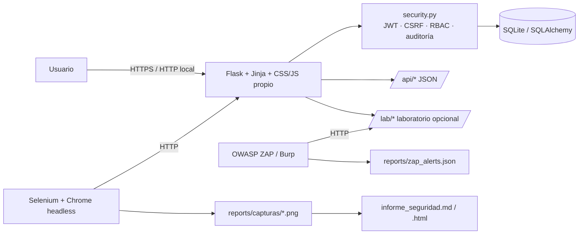

# Arquitectura del proyecto

## 1. Vista general

## 2. Capas

| Capa | Archivos | Responsabilidad |
| --- | --- | --- |
| Configuración | `app/config.py`, `.env.example`, `run.py` | Secretos por entorno, TTL de tokens, modo laboratorio. |
| Dominio | `app/models.py`, `app/seed.py` | Usuarios (3 roles), cursos, inscripciones, bitácora. |
| Seguridad | `app/security.py` | Creación/validación de JWT, doble envío CSRF, RBAC, auditoría, rate limit, `safe_next`. |
| Web | `app/routes/web.py`, `app/templates/`, `app/static/` | Pantallas renderizadas en servidor, diseño celeste/azul/blanco, iconos SVG. |
| API | `app/routes/api.py`, `app/routes/auth.py` | JSON para login, cursos, calificaciones, usuarios y auditoría. |
| Laboratorio | `app/routes/lab.py` | Seis vulnerabilidades controladas y sus versiones seguras. |
| Pruebas | `tests/`, `scripts/`, `reports/` | Selenium, pytest, capturas, generación del informe, ZAP. |

## 3. Flujo de una petición autenticada

1. `GET /login` entrega la página y la cookie `psw_csrf` (no HttpOnly, legible por el JS).
2. `POST /api/auth/login` verifica que la cabecera `X-CSRF-Token` coincida con la cookie, comprueba
   bcrypt, aplica límite de intentos y devuelve `psw_access` (HttpOnly, 15 min) y `psw_refresh`
   (HttpOnly, 7 días, restringido a `/api/auth/refresh`).
3. Cada ruta protegida usa `@require_auth(roles=...)`, que decodifica y verifica firma/expiración del
   JWT, carga el usuario desde la base de datos y comprueba su rol.
4. Las escrituras añaden `@require_csrf`.
5. `after_request` añade las cabeceras de seguridad y `Cache-Control: no-store`. Las rutas marcadas
   como vulnerables (`g.skip_security_headers`) omiten este paso de forma deliberada.

## 4. Modelo de datos

- **User**: credenciales bcrypt, rol (`admin`, `docente`, `estudiante`), estado, intentos fallidos.
- **Course**: código único, nombre, horario, aula, docente responsable.
- **Enrollment**: relación estudiante-curso con calificación opcional (0-20).
- **AuditLog**: evento, usuario, IP, nivel (`info`, `warn`, `error`) y marca de tiempo.

## 5. Modos de ejecución

| Modo | Cómo activarlo | Rutas `/lab/*` | Uso |
| --- | --- | --- | --- |
| Seguro (por defecto) | `python run.py` | No registradas (404) | Desarrollo, demostración, producción. |
| Laboratorio | `python run.py --lab` o `LAB_MODE=1` | Registradas y marcadas en la UI | Pruebas con ZAP/Burp y captura de evidencias. |

> El laboratorio existe únicamente como entorno académico aislado. Nunca debe habilitarse en un
> servidor accesible desde Internet.

## 6. Decisiones de diseño

- **Cookies HttpOnly + CSRF explícito** en lugar de guardar tokens en `localStorage`: evita que un XSS
  lea el token directamente y defiende contra solicitudes forjadas.
- **Plantillas Jinja con autoescape** y escape explícito en las respuestas HTML del laboratorio.
- **SQLAlchemy ORM** en toda la aplicación de negocio; la concatenación SQL existe sólo en el endpoint
  vulnerable del laboratorio.
- **Manejadores de error centralizados** para no filtrar trazas; el error detallado existe sólo como
  demostración controlada.
- **Diseño sin dependencias visuales externas**: CSS propio, tipografía del sistema y sprite SVG local,
  de modo que las capturas se vean igual sin conexión.
