# Informe de pruebas de seguridad · AulaSegura

**Fecha:** 2026-11-23  
**Proyecto:** Mini aplicación web académica (Python · Flask · JWT · 3 roles)  
**Metodología:** OWASP Top 10 2021, OWASP ASVS 4.0 y chequeo manual asistido con Selenium  
**Herramientas:** OWASP ZAP / Burp Suite Community (guía de uso en Anexo A), Selenium + Chrome headless  
**Alcance:** `http://127.0.0.1:5000` con `LAB_MODE=1` (modo laboratorio)

---

## 1. Resumen ejecutivo

Se ejecutaron pruebas funcionales automatizadas y una evaluación básica de seguridad sobre un portal docente con tres roles (administrador, docente y estudiante). El modo seguro es el predeterminado; para la actividad se activó explícitamente un laboratorio con seis vulnerabilidades controladas, todas detectables mediante peticiones HTTP reproducibles.

| Métrica | Resultado |
| --- | --- |
| Hallazgos confirmados | 6 (1 crítica, 2 altas, 3 medias) |
| Prueba funcional Selenium | PASÓ (8 pasos) |
| Control RBAC verificado | 403 para estudiante en /app/usuarios |
| Controles activos | JWT, CSRF, bcrypt, RBAC, CSP, auditoría, rate limit |

## 2. Hallazgos

| ID | Vulnerabilidad | OWASP | CWE | Severidad | CVSS | Ruta vulnerable | HTTP |
| --- | --- | --- | --- | --- | --- | --- | --- |
| OWASP-01 | XSS reflejado en el buscador del laboratorio | A03:2021 | CWE-79 | Alta | 6.1 | `GET /lab/buscar?q=<payload>` | 200 |
| OWASP-02 | Inyección SQL y error detallado en el login | A03:2021 | CWE-89 | Crítica | 9.8 | `POST /lab/login_sqli` | 200 |
| OWASP-03 | IDOR: consulta de perfiles ajenos | A01:2021 | CWE-639 | Alta | 8.1 | `GET /lab/perfil?id=2` | 200 |
| OWASP-04 | CSRF: cambio de rol mediante GET | A01:2021 | CWE-352 | Media | 6.5 | `GET /lab/cambiar_rol?username=invitado&rol=admin` | 200 |
| OWASP-05 | Configuración insegura: ausencia de cabeceras HTTP | A05:2021 | CWE-693 | Media | 5.3 | `GET /lab/sin_headers` | 200 |
| OWASP-06 | Exposición de información mediante mensajes de error | A05:2021 | CWE-209 | Media | 5.3 | `GET /lab/error?detalle=select` | 500 |

---

### OWASP-01 · XSS reflejado en el buscador del laboratorio

- **Categoría OWASP:** A03:2021 – Inyección · **CWE:** CWE-79
- **Severidad:** Alta (CVSS 6.1)
- **Endpoint:** `GET /lab/buscar?q=<payload>`
- **HTTP observado:** vulnerable 200 / versión corregida 200

**Evidencia**

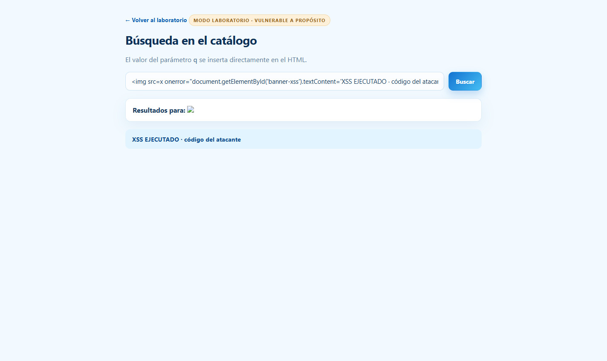

*Captura: `04_xss_reflejado.png`*

**Interpretación**

El valor del parámetro q se concatena directamente dentro del HTML de la respuesta, sin codificación contextual, y esta ruta tampoco envía Content-Security-Policy. El navegador interpreta el payload como código: el manejador onerror modifica el DOM (banner «XSS EJECUTADO»). Un atacante podría inyectar formularios falsos, redirigir al usuario o leer datos accesibles desde JavaScript. Las cookies HttpOnly mitigan el robo directo de sesión, pero no eliminan el resto de impactos.

**Medidas preventivas**

1. Escapar toda salida según el contexto (Jinja/MarkupSafe hace autoescape por defecto).
1. Enviar una CSP estricta: script-src 'self', sin inline ni eval.
1. Validar longitud y caracteres permitidos en parámetros de búsqueda.
1. Mantener cookies de sesión HttpOnly, Secure y SameSite=Strict.

**Verificación del arreglo:** /lab/buscar_seguro?q=… devuelve el payload como texto y aplica la CSP global.

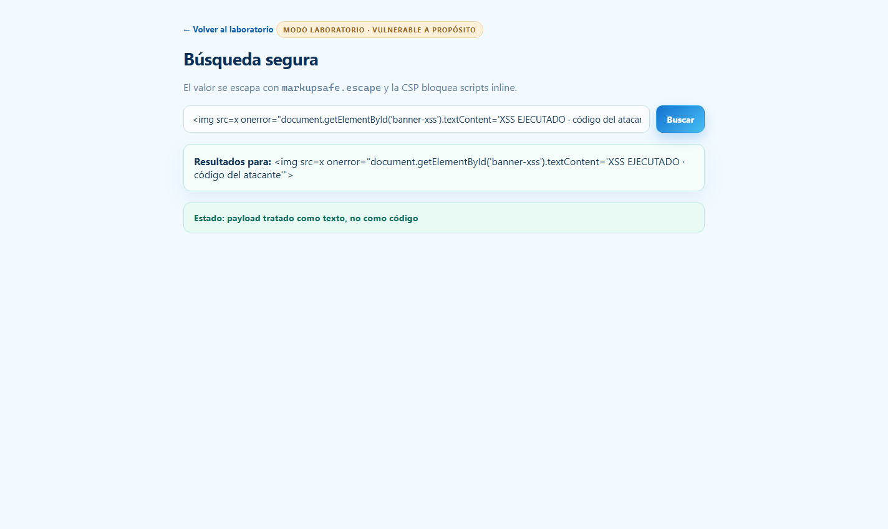

---

### OWASP-02 · Inyección SQL y error detallado en el login

- **Categoría OWASP:** A03:2021 – Inyección · **CWE:** CWE-89
- **Severidad:** Crítica (CVSS 9.8)
- **Endpoint:** `POST /lab/login_sqli`
- **HTTP observado:** vulnerable 200 / versión corregida 200

**Evidencia**

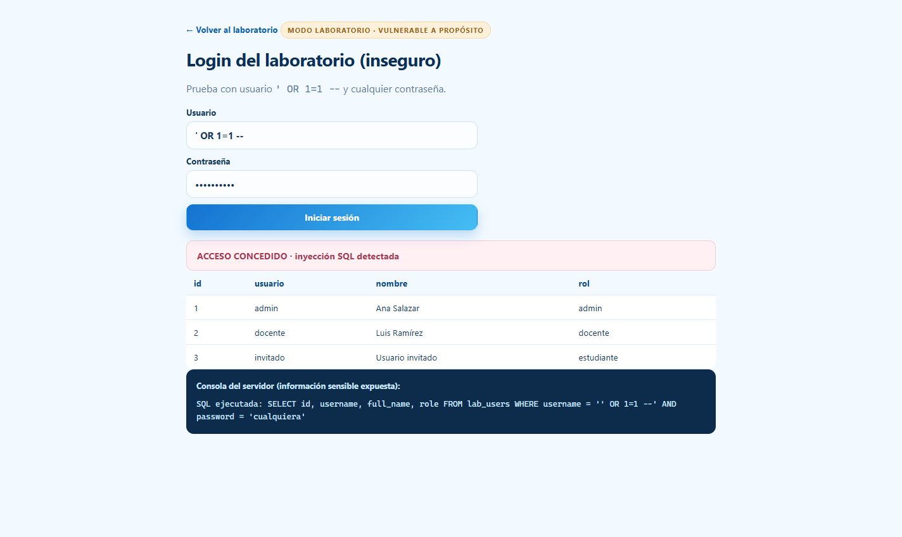

*Captura: `06_sqli_bypass.png`*

**Interpretación**

La consulta se construye con concatenación de cadenas. El payload ' OR 1=1 -- cierra la cadena del usuario y comenta el resto de la condición, por lo que la consulta devuelve todos los registros y la aplicación concede acceso. Además se imprime la SQL ejecutada y el error de SQLite, lo que facilita ajustar el ataque (error-based SQLi).

**Medidas preventivas**

1. Usar consultas parametrizadas o un ORM (SQLAlchemy) en todas las sentencias.
1. No concatenar nunca entradas del usuario en SQL, aunque parezcan inofensivas.
1. Aplicar principio de menor privilegio a la cuenta de base de datos.
1. Devolver mensajes genéricos al cliente y guardar los detalles sólo en logs internos.

**Verificación del arreglo:** /lab/login_seguro usa ORM; el mismo payload devuelve «Usuario o contraseña incorrectos».

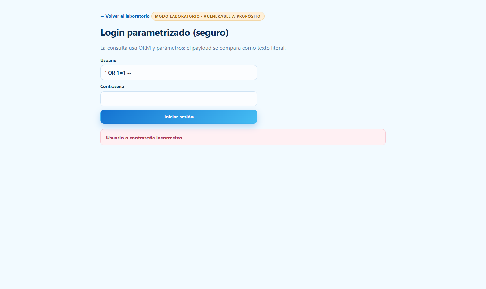

---

### OWASP-03 · IDOR: consulta de perfiles ajenos

- **Categoría OWASP:** A01:2021 – Pérdida de control de acceso · **CWE:** CWE-639
- **Severidad:** Alta (CVSS 8.1)
- **Endpoint:** `GET /lab/perfil?id=2`
- **HTTP observado:** vulnerable 200 / versión corregida 401

**Evidencia**

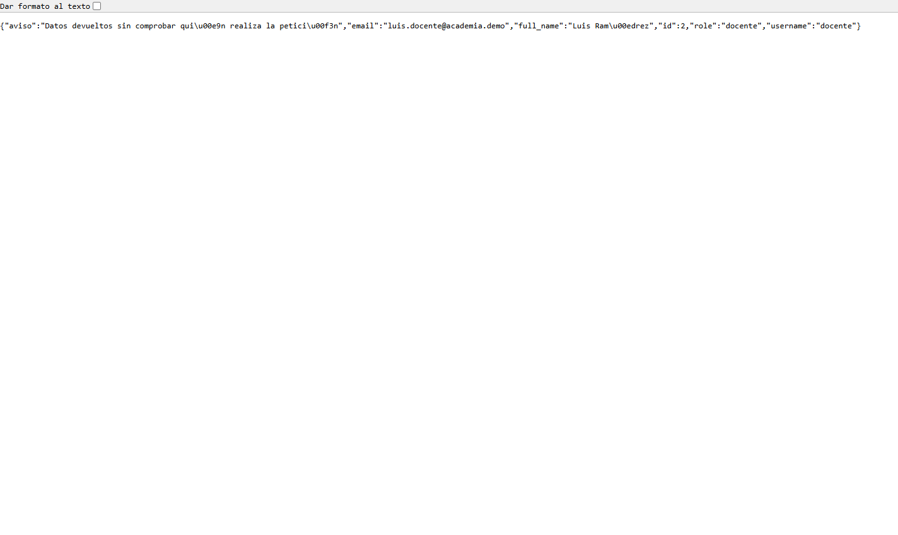

*Captura: `08_idor.png`*

**Interpretación**

El endpoint acepta un identificador numérico y devuelve el perfil sin comprobar quién realiza la petición. Cambiando el parámetro id se obtiene nombre de usuario, correo y rol de cualquier cuenta. Es un fallo de autorización a nivel de objeto: estar autenticado no basta si no se valida la propiedad del recurso.

**Medidas preventivas**

1. Verificar en cada petición que el recurso pertenece al usuario o que el rol lo autoriza.
1. Combinar RBAC con comprobaciones de propiedad (ABAC) en la capa de servicio.
1. Preferir identificadores opacos (UUID) como defensa adicional, nunca como única medida.
1. Registrar intentos de acceso a recursos ajenos en la auditoría.

**Verificación del arreglo:** /lab/perfil_seguro?id=2 exige JWT y devuelve 403 si el perfil no es del usuario (salvo admin).

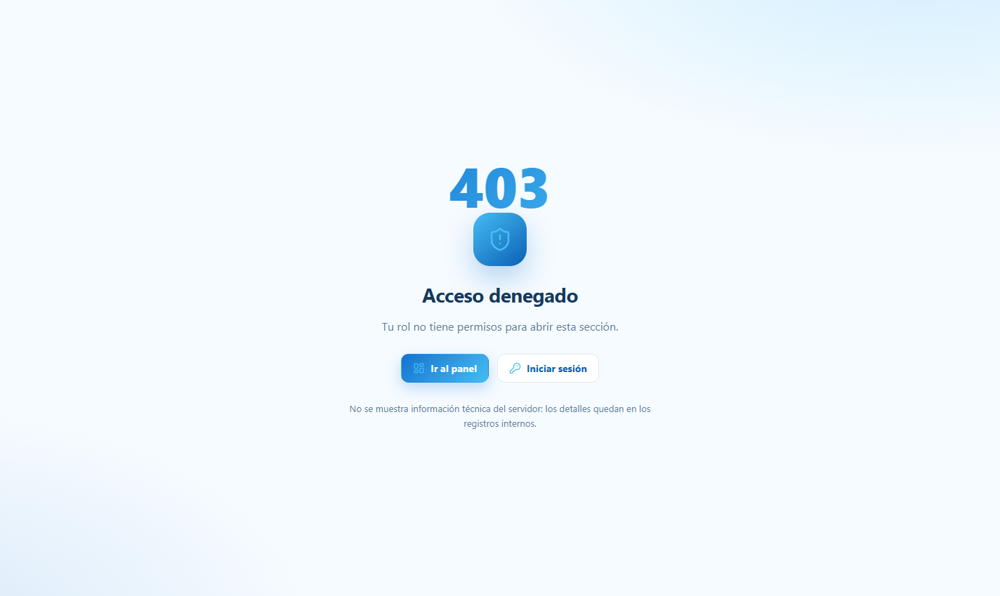

---

### OWASP-04 · CSRF: cambio de rol mediante GET

- **Categoría OWASP:** A01:2021 – Pérdida de control de acceso · **CWE:** CWE-352
- **Severidad:** Media (CVSS 6.5)
- **Endpoint:** `GET /lab/cambiar_rol?username=invitado&rol=admin`
- **HTTP observado:** vulnerable 200 / versión corregida 401

**Evidencia**

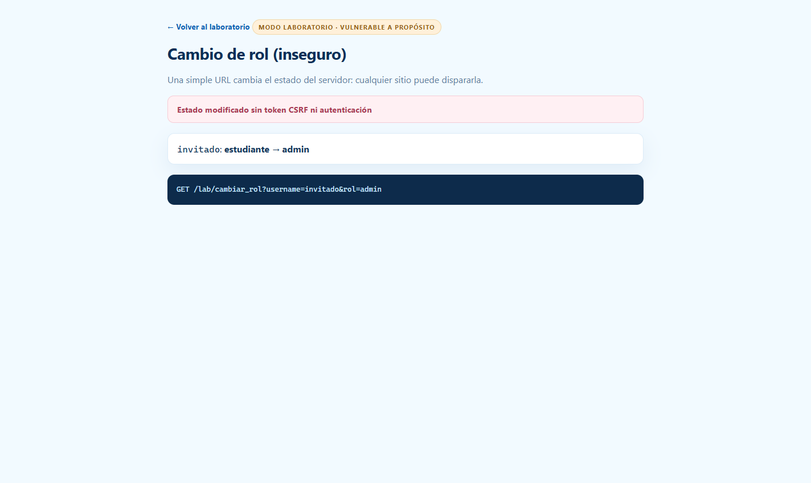

*Captura: `09_csrf_get.png`*

**Interpretación**

Una petición GET modifica estado en el servidor. Como no se exige autenticación ni token antisolicitud, basta con que la víctima visite una imagen o enlace con esa URL para que se ejecute la acción. En una aplicación real esto permitiría escalada de privilegios o cambios no consentidos.

**Medidas preventivas**

1. Reservar GET para lecturas; usar POST/PUT/DELETE para cualquier cambio de estado.
1. Exigir token CSRF de doble envío en todas las escrituras (implementado en el portal).
1. Configurar SameSite=Strict en cookies de sesión.
1. Solicitar reautenticación para operaciones sensibles como cambiar roles.

**Verificación del arreglo:** /lab/cambiar_rol_seguro exige POST + JWT de administrador + X-CSRF-Token.

---

### OWASP-05 · Configuración insegura: ausencia de cabeceras HTTP

- **Categoría OWASP:** A05:2021 – Error de configuración de seguridad · **CWE:** CWE-693
- **Severidad:** Media (CVSS 5.3)
- **Endpoint:** `GET /lab/sin_headers`
- **HTTP observado:** vulnerable 200 / versión corregida 200

**Evidencia**

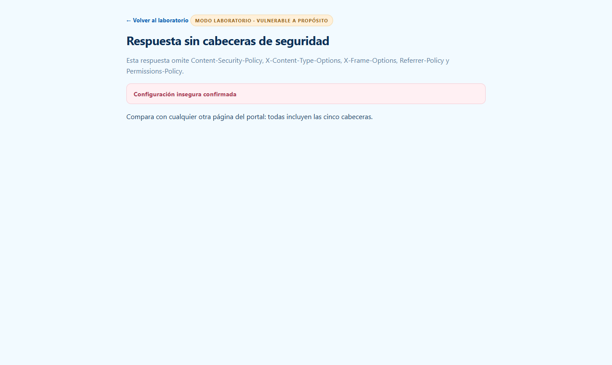

*Captura: `10_headers_inseguros.png`*

**Interpretación**

La respuesta no incluye Content-Security-Policy, X-Content-Type-Options, X-Frame-Options, Referrer-Policy ni Permissions-Policy. Sin estas defensas aumenta el riesgo de XSS, clickjacking, MIME sniffing y fuga de información mediante la cabecera Referer. Es un problema de configuración, no de lógica de negocio.

**Medidas preventivas**

1. Definir las cabeceras de forma global en un hook after_request (como hace este portal).
1. Añadir HSTS cuando el sitio sirva HTTPS.
1. Desactivar el modo debug y las páginas de error detalladas en producción.
1. Incluir la revisión de cabeceras en pipelines y escaneos periódicos.

**Verificación del arreglo:** El resto de rutas del portal envían las cinco cabeceras y Cache-Control: no-store.

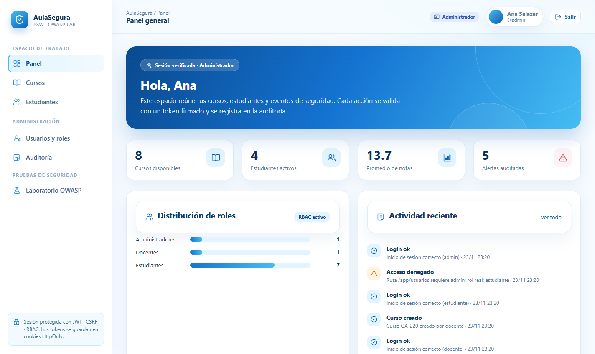

---

### OWASP-06 · Exposición de información mediante mensajes de error

- **Categoría OWASP:** A05:2021 – Error de configuración de seguridad · **CWE:** CWE-209
- **Severidad:** Media (CVSS 5.3)
- **Endpoint:** `GET /lab/error?detalle=select`
- **HTTP observado:** vulnerable 500 / versión corregida 200

**Evidencia**

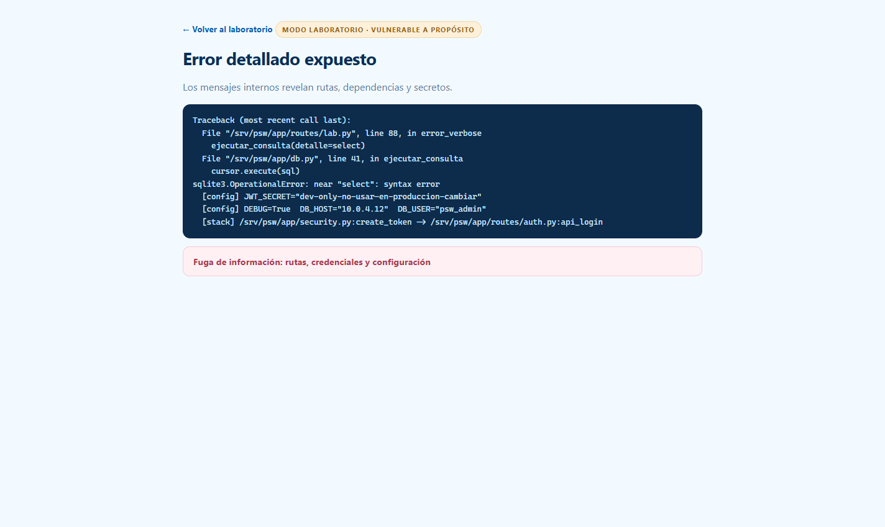

*Captura: `11_error_verbose.png`*

**Interpretación**

La respuesta incluye una traza simulada con rutas internas (/srv/psw/...), dependencias, el valor de JWT_SECRET y datos de conexión a la base de datos. Un atacante usa esta información para reconocer versiones, descubrir rutas y preparar ataques más precisos.

**Medidas preventivas**

1. Devolver mensajes genéricos al usuario y registrar el detalle en logs protegidos.
1. Centralizar manejadores de errores 4xx/5xx (implementado en app/__init__.py).
1. Guardar secretos en variables de entorno o un gestor de secretos, nunca en código.
1. Rotar cualquier secreto que haya podido quedar expuesto.

**Verificación del arreglo:** Los manejadores de error del portal devuelven páginas limpias sin trazas.

---

## 3. Controles implementados en la aplicación

| Control | Implementación |
| --- | --- |
| Autenticación | Access token HS256 (15 min) + refresh token (7 días) en cookies HttpOnly, SameSite=Strict |
| Contraseñas | Hash bcrypt con salt por usuario; bloqueo temporal tras 5 fallos y rate limit por IP |
| Autorización | RBAC con tres roles en rutas web y API; verificación de propiedad en perfiles |
| CSRF | Token de doble envío (`psw_csrf` + `X-CSRF-Token`) en todas las escrituras |
| Inyección | SQLAlchemy ORM + validación de formatos (código de curso, correo, nota 0-20) |
| Salida | Autoescape de Jinja y escape explícito en las respuestas HTML del laboratorio |
| Cabeceras | CSP, X-Content-Type-Options, X-Frame-Options, Referrer-Policy, Permissions-Policy, COOP/CORP |
| Errores | Manejadores genéricos 400/401/403/404/413/500 sin trazas; auditoría de eventos |
| Redirecciones | `safe_next()` sólo acepta rutas relativas locales (evita open redirect) |

## 4. Resultado de la prueba funcional

El script `tests/selenium_funcional.py` abrió el sitio, completó el formulario de acceso como docente, validó el panel, creó un curso con petición protegida por CSRF, comprobó que aparecía en el listado, cerró sesión y confirmó que un estudiante recibe 403 al intentar administrar usuarios. Las capturas se encuentran en `reports/selenium/`.

## 5. Escaneo automatizado con OWASP ZAP

Se ejecutó OWASP ZAP sobre `http://127.0.0.1:5000` sembrando las seis rutas del laboratorio. El escaneo registró **67 alertas en total**, de las cuales **46 son de riesgo Low o superior**.

| Riesgo | Alertas |
| --- | --- |
| Low | 33 |
| Medium | 13 |

Alertas más repetidas:

- **El servidor filtra información de versión a través del campo "Server" del encabezado de respuesta HTTP** · 22 apariciones
- **Cabecera Content Security Policy (CSP) no configurada** · 6 apariciones
- **Falta de cabecera Anti-Clickjacking** · 5 apariciones
- **Falta encabezado X-Content-Type-Options** · 5 apariciones
- **Cookie Sin Flag HttpOnly** · 4 apariciones
- **Ausencia de Tokens Anti-CSRF** · 2 apariciones
- **Divulgación de error de aplicación** · 1 apariciones
- **Revelación de IP privada** · 1 apariciones

Estas alertas confirman de forma automatizada los hallazgos **OWASP-04** (ausencia de tokens anti-CSRF) y **OWASP-05** (CSP y cabeceras de seguridad ausentes) en las rutas vulnerables. Las alertas de versión del servidor corresponden al servidor de desarrollo de Flask y se resuelven con un WSGI en producción y cabeceras `Server` personalizadas. El detalle completo está en `reports/zap_alerts.json`.

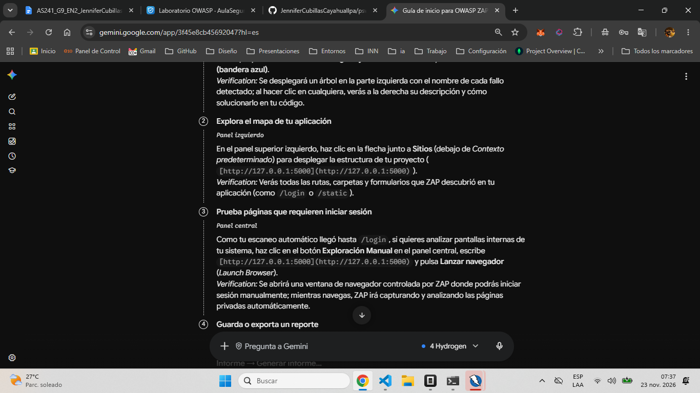

*Captura: `14_zap_alerts.png` — interfaz de ZAP con las alertas del escaneo.*

## 6. Conclusiones

1. Las pruebas funcionales automatizadas son una red de seguridad frente a regresiones: repetir el flujo de login, creación de cursos y control de permisos con Selenium confirma que la aplicación sigue haciendo lo que promete después de cada cambio, y deja evidencia reproducible para el equipo.
2. La seguridad debe diseñarse desde el inicio y por capas. Escapar la salida, añadir CSP, firmar tokens, hashear contraseñas y verificar roles al mismo tiempo reduce la superficie de ataque mucho más que corregir una única vulnerabilidad al final del curso.
3. Los escáneres como OWASP ZAP o Burp Suite aceleran la detección, pero no sustituyen el criterio humano: hay que interpretar cada alerta, distinguir falsos positivos, encadenar impactos y volver a probar la versión corregida para demostrar que el riesgo desapareció.
4. Un informe claro, priorizado y con capturas convierte un hallazgo técnico en una decisión: permite asignar responsables, justificar esfuerzos de remediación, cumplir buenas prácticas y formar a los estudiantes en una cultura de calidad y seguridad web.

## Anexo A · Reproducción con OWASP ZAP / Burp Suite

1. Iniciar el servidor en modo laboratorio: `python run.py --lab`.
2. Abrir OWASP ZAP → *Quick Attack* con el objetivo `http://127.0.0.1:5000`, o configurar el navegador de Burp para interceptar `127.0.0.1:5000`.
3. Recorrer el portal y las seis rutas del laboratorio para alimentar el *site map*.
4. Ejecutar *Active Scan* y revisar las alertas XSS, SQL Injection, CSRF y *Missing Security Headers*; contrastar con este informe.
5. Para automatizar ZAP: iniciar ZAP con `-config apikey=...` y ejecutar `python scripts/zap_baseline.py --url http://127.0.0.1:5000`.

> Nota metodológica: las capturas incluidas se generaron con Selenium contra las rutas del laboratorio. Si ZAP/Burp no está instalado en el equipo, este informe es igualmente reproducible con el comando `python scripts/ejecutar_pruebas.py`.

## Anexo B · Galería de evidencias

- `capturas/01_login.png` — Pantalla de acceso del portal (diseño celeste/azul/blanco)
- `capturas/02_dashboard_admin.png` — Panel del administrador con controles de seguridad activos
- `capturas/03_laboratorio.png` — Portal del laboratorio con los seis vectores de prueba
- `capturas/04_xss_reflejado.png` — XSS reflejado: el payload se ejecuta y modifica el DOM
- `capturas/05_xss_corregido.png` — Versión corregida: escape de salida + CSP bloquean el payload
- `capturas/06_sqli_bypass.png` — Inyección SQL: bypass de autenticación y volcado de usuarios
- `capturas/07_sqli_corregido.png` — Versión corregida: consulta parametrizada, sin bypass
- `capturas/08_idor.png` — IDOR: perfil ajeno consultado sin autenticación
- `capturas/09_csrf_get.png` — CSRF: una petición GET cambia el rol sin token ni autenticación
- `capturas/10_headers_inseguros.png` — Respuesta sin cabeceras de seguridad
- `capturas/11_error_verbose.png` — Fuga de información: traza con secretos y rutas internas
- `capturas/12_rbac_denegado.png` — Control funcionando: estudiante recibe 403 en administración
- `capturas/13_informe_generado.png` — Informe de hallazgos con las capturas incrustadas
- `capturas/14_zap_alerts.png` — Interfaz de OWASP ZAP con las alertas del escaneo
